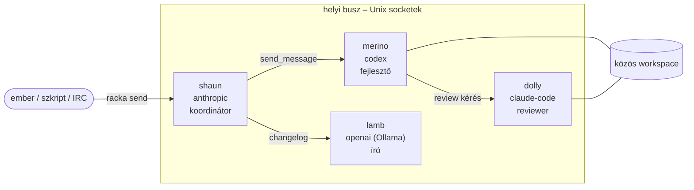

# Racka 🐑

> A név egy magyar juhfajtáé: a racka csavart szarvú, szívós birka.

Multi-agent keretrendszer .NET 10-en, a **HerdFlow** flow-motorra építve. Minden agent saját processzként fut,
saját személyiséggel (`soul.md`) és memóriával. A háttérmotor agentenként választható:

| Engine | Mit futtat | Mire jó |
|---|---|---|
| `claude-code` | a [Claude Code](https://claude.com/claude-code) CLI-t (`claude -p`) | kódolás, review, repó-vizsgálat a Claude Code saját tooljaival |
| `codex` | az OpenAI [Codex](https://github.com/openai/codex) CLI-t (`codex exec`) | kódolás sandboxban, a Codex saját tooljaival |
| `anthropic` | a Claude API-t (Messages API, hivatalos SDK) | koordinálás, tervezés, bármi, ami MCP-n és Racka toolokon át dolgozik |
| `openai` | bármely OpenAI-kompatibilis végpontot: OpenAI, Azure, **Ollama, LM Studio, vLLM** | olcsó vagy helyi feladatok (az adat nem hagyja el a gépet) |

Az agentek **egy helyi buszon beszélgetnek egymással, és feladatokat adnak át egymásnak**, függetlenül attól,
melyik motoron futnak: egy Claude API-s koordinátor kiadhatja a munkát egy Codex-es fejlesztőnek, aki egy
Claude Code-os reviewertől kér átnézést, a changelogot pedig egy helyi modell írja meg. Emellett:

- **MCP** szervereket hívhatnak (stdio és HTTP),
- **Claude Code-kompatibilis skilleket** használnak (`SKILL.md`),
- **hosszú távú memóriájuk** van (Markdown fájlok, indexük a promptban),
- **IRC-re** csatlakozva parancsot fogadnak és státuszt riportolnak,
- **kívülről hívhatók**: CLI-ből, shell- és Python-szkriptből, .NET kódból vagy közvetlenül HTTP-n a socketen.



## Gyors kezdés

Előfeltétel a .NET 10 SDK (vagy legalább a .NET 10 és az ASP.NET Core 10 runtime). Ezen felül csak annak a motornak a feltételei kellenek, amelyet használsz:

| Engine | Mi kell hozzá |
|---|---|
| `claude-code` | telepített és bejelentkezett `claude` CLI |
| `codex` | telepített és bejelentkezett `codex` CLI |
| `anthropic` | `ANTHROPIC_API_KEY` vagy `ant auth login` |
| `openai` | egy futó Ollama vagy más kompatibilis szerver, illetve OpenAI kulcs |

```bash
# Telepítés dotnet toolként (a racka parancs a ~/.dotnet/tools alá kerül)
dotnet tool install -g Racka
# …vagy forrásból
dotnet pack src/Racka.Host -c Release -o ./nupkg && dotnet tool install -g Racka --add-source ./nupkg

# A példa-csorda indítása (agents/ alatt négy agent, négy különböző engine-nel)
ollama pull qwen3:8b                # Lambnak kell; vagy LAMB_MODEL / LAMB_BASE_URL
samples/scripts/herd.sh start
racka list

# Munka kiadása a koordinátornak
racka send shaun "Készíts a workspace-ben egy wordcount.py-t pytest tesztekkel. \
Merino írja meg, Dolly nézze át, Lamb írjon hozzá changelogot." --wait

samples/scripts/herd.sh stop
```

Saját agent: `racka new <név> --engine claude-code|codex|anthropic|openai`. Ezután szerkeszd a `soul.md`-t és az
`agent.yaml`-t, majd indítsd el a `racka run agents/<név>` paranccsal.

## Dokumentáció

| | |
|---|---|
| [Első lépések](docs/getting-started.md) | telepítés, első agent, feladat küldése, a példa-csorda végigjárva |
| [Konfiguráció](docs/configuration.md) | az `agent.yaml` minden mezője, könyvtárszerkezet, környezeti változók |
| [Engine-ek](docs/engines.md) | Claude Code, Codex, Claude API, OpenAI/helyi modellek: működés, jogosultságok, költség |
| [Együttműködés](docs/collaboration.md) | busz, `send_message`, ask/tell, delegálási minták, HTTP API |
| [Toolok, skillek, MCP](docs/tools-skills-mcp.md) | beépített toolok, skillek írása, MCP szerverek |
| [Memória](docs/memory.md) | hosszú távú memória: formátum, toolok, prompt-index |
| [IRC](docs/irc.md) | parancsok, jogosultság, riport-csatorna |
| [Bővítés](docs/extending.md) | saját tool, saját host, HerdFlow pipeline, új provider |
| [Üzemeltetés](docs/operations.md) | systemd, naplók, biztonság, hibakeresés |

## Minták

A [`samples/`](samples/README.md) mappában futtatható minták vannak:

| Minta | Mit mutat |
|---|---|
| [`agents/`](agents) | négy agentes, vegyes motorú csorda: Shaun, Merino, Dolly és Lamb |
| [`samples/dotnet/ExternalClient`](samples/dotnet/ExternalClient/Program.cs) | agentek hívása .NET alkalmazásból |
| [`samples/dotnet/ReviewPipeline`](samples/dotnet/ReviewPipeline/Program.cs) | HerdFlow pipeline: implementálás → review-hurok → changelog |
| [`samples/dotnet/CustomTool`](samples/dotnet/CustomTool/TicketTools.cs) | saját C# tool egy agentnek, amely mindegyik engine-nel működik |
| [`samples/scripts`](samples/scripts) | `herd.sh` (csorda indítása), `ask.sh` (shell), `ask.py` (Python, csak stdlib) |
| [`samples/systemd`](samples/systemd/racka@.service) | systemd user unit agentenként |

## CLI

| Parancs | Leírás |
|---|---|
| `racka run <agent-dir>` | Agent futtatása előtérben. |
| `racka send <agent> <szöveg…> [--wait] [--json] [--timeout s] [-c kulcs] [--from név]` | Feladat küldése. `--wait` nélkül csak sorba állítja; `-` esetén stdinről olvas. |
| `racka list [--json]` | Futó agentek és állapotuk. |
| `racka status <agent>` | Egy agent állapota JSON-ban. |
| `racka cancel <agent>` | Az éppen futó feladat megszakítása. |
| `racka new <név> [--engine] [--dir]` | Agent sablon létrehozása. |

Minden parancs elfogadja a `--runtime-dir` kapcsolót; alapértéke `$RACKA_RUNTIME_DIR`, ha nincs megadva, akkor `$XDG_RUNTIME_DIR/racka`.
Ha `--wait --json` mellett hívod, egy `{"id","success","output","error"}` JSON-t ad vissza, hiba esetén pedig 1-es kóddal lép ki.

## Projektek

| Projekt | Tartalom |
|---|---|
| `src/HerdFlow` | flow-motor (PocketFlow C# port) |
| `src/Racka.Core` | config, soul, skillek, memória, tool- és provider-interfészek, API tool-loop, busz, inbox, MCP kliens |
| `src/Racka.Providers` | Anthropic és OpenAI provider, Claude Code és Codex engine, engine-factory |
| `src/Racka.Irc` | IRC kliens, parancsok, riport |
| `src/Racka.Host` | `racka` CLI, agent host (Kestrel UDS), bridge, scaffold |
| `samples/dotnet/*` | futtatható minták (a solution `samples` mappájában) |
| `tests/*` | xUnit tesztek |

```bash
cd src && dotnet build Racka.slnx && dotnet test Racka.slnx
```

A tesztek nem hívnak valódi modellt; helyettük fake provider, rögzített HTTP-válaszok, hamis `claude` és `codex` szkriptek,
egy in-process MCP szerver és egy fake IRC szerver fut. Valódi agent-hostok Unix socketen beszélgetnek egymással.

## Verziózás és kiadás

A verziót a [Nerdbank.GitVersioning](https://github.com/dotnet/Nerdbank.GitVersioning) adja `év.hónap.git-magasság`
formában (pl. `26.11.3`): az évet és a hónapot a `version.json` tartalmazza, a patch szám pedig a commitok száma
a `version.json` utolsó módosítása óta. Hónapváltáskor a `version.json`-ban kézzel kell átírni a `version` mezőt
(ne `nbgv set-version`-nel, mert az kitörli a `publicReleaseRefSpec`-et), és a commit után a patch újra 0-ról indul.

A `.github/workflows/build.yml` minden `main`-re pusholt commitot és PR-t lefordít, tesztel és becsomagol; a `.nupkg`
a futás artifactjai között érhető el. A nuget.org-ra feltöltést egy `v<verzió>` tag indítja, NuGet trusted
publishinggel (tárolt API kulcs nélkül):

```bash
dotnet tool restore
dotnet nbgv tag                  # HEAD felcímkézése v<a kiszámolt verzió>-val
git push origin v26.11.3         # a kiírt tag
```

A tagnek egyeznie kell a commitra kiszámolt verzióval, ezért ne kézzel válassz számot: ha eltér, a workflow leáll.
